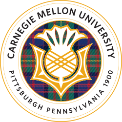

Xingchen is a Ph.D. candidate under the supervision of [Dr. Lu Su](https://engineering.purdue.edu/~lusu/) in the department of [Electrical and Computer Engineering](https://engineering.purdue.edu/ECE) at [Purdue University](https://www.purdue.edu/). Before Ph.D. study, he got his Master of Science degree in [Electrical and Computer Engineering](https://www.ece.cmu.edu/) from [Carnegie Mellon University](https://www.cmu.edu/) and got his Bachelor of Science degree in Computer Engineering from [Purdue University](https://www.purdue.edu/).

His research bridges **efficient on-device AI systems** and **multi-sensor physical perception**, designing algorithms and systems that bring foundation models and real-time intelligence onto resource-constrained edge hardware without compromising privacy or reliability. Specifically, his work spans efficient LLM inference and agentic retrieval, privacy-preserving and heterogeneity-aware federated learning, and multi-modal sensing across acoustic, mmWave, LiDAR, and camera modalities. Alongside his doctoral studies, Xingchen has also gained industry research experience through internships at **NVIDIA**, **Adobe Research**, and **Nokia Bell Labs**.

#### Email
wang2930[at]purdue.edu

#### Education

Ph.D in Electrical and Computer Engineering, Purdue University, 2027.

M.S. in Electrical and Computer Engineering, Carnegie Mellon University, 2021.

B.S. (with highest distinction) in Computer Engineering, Purdue University, 2019.

#### Research Interests
Wireless Sensing, Sensor Fusion, Federated Learning, Multi-Modal and On-Device Intelligence.

